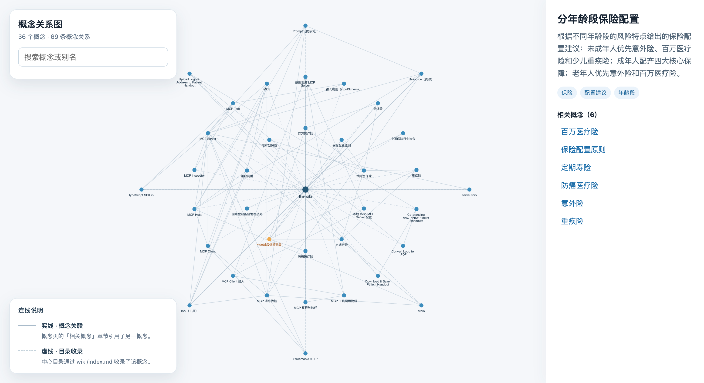

# llm-wiki

**把学习资料变成能提问、能追溯来源的个人 Wiki。**

`llm-wiki` 是一个开源命令行项目：导入网页、在线 PDF 和本地 PDF/TXT/Markdown/XLSX/XLS 文件，将资料整理为 Markdown，再借助大语言模型编译成结构化 Wiki。无论是整理课程笔记、研究新技术，还是想借这个项目学习 LLM Wiki 的实现，你都可以沿着“导入 → 编译 → 查看关系图 → 向量化 → 提问”的流程边用边学。

**从一篇资料开始：** 先 [安装](#安装)，运行 `llm-wiki start <网页地址>`；需要编译和提问时，再按 [配置](#配置) 接入模型。

### 从资料到知识地图

`llm-wiki` 将分散的资料编译成结构化 Wiki，并把概念之间的联系呈现在可交互的关系图中。运行 `llm-wiki view`，即可搜索概念、探索关联，点选节点查看摘要、标签与相关概念。



各版本的新增功能、修复与维护记录见 [更新日志](CHANGELOG.md)。

## 环境要求

- Node.js 24.15.0 或更高版本。
- 一个 OpenAI 兼容的模型接口。

## 安装

```bash
npm install --global @lihaichao/llm-wiki
```

## 配置

运行编译或查询命令前，设置模型和兼容接口的环境变量：

```bash
export LLM_MODEL="<模型名称>"
export LLM_API_KEY="<API Key>"
export LLM_BASE_URL="<兼容接口地址>"
```

`LLM_BASE_URL` 为必填项，须填写不含查询参数或片段的 HTTP(S) 接口根地址。使用 OpenAI 时填写 `https://api.openai.com/v1`；使用其他服务时填写该服务提供的 OpenAI 兼容接口根地址。程序会在模型请求前检查该配置。

运行向量化命令还需要配置 OpenRouter Inference Token：

```bash
export OPENROUTER_API_KEY="<OpenRouter Access Token>"
```

该 Token 需要具备 Inference 权限。向量命令使用 OpenRouter 上的 `baai/bge-m3` 模型。

不要将真实的 API Key 写入 README、代码或提交历史。

## 使用

### 命令一览

| 命令 | 作用 |
| --- | --- |
| `llm-wiki start <input>` | 导入网页、在线 PDF、本地 PDF/TXT/Markdown/XLSX/XLS 文件或文件夹，并保存为 Markdown。 |
| `llm-wiki start <input> --concurrency <数量>` | 递归导入文件夹时设置同时处理的任务数量，默认 3。 |
| `llm-wiki compile` | 将 `sources/` 中的 Markdown 资料整理为 `wiki/` 下的 Wiki 内容。 |
| `llm-wiki compile --concurrency <数量>` | 编译资料，并设置同时处理的任务数量。 |
| `llm-wiki view` | 在浏览器中查看 `wiki/concepts/` 的概念关系图。 |
| `llm-wiki vector` | 为 `wiki/concepts/` 中的内容生成向量，保存到 `.llmwiki/embedding.json`。 |
| `llm-wiki query <question>` | 检索向量索引，并根据相关 Wiki 内容生成带来源的回答。 |
| `llm-wiki --help` | 查看命令帮助。 |
| `llm-wiki --version`、`llm-wiki -V` | 查看当前版本。 |

### `start` 支持的输入

| 输入来源 | 支持格式与示例 | 导入内容 |
| --- | --- | --- |
| 在线网页 | HTTP(S) 文章地址，如 `https://example.com/article` | 提取正文并转换为 Markdown |
| 在线 PDF | 路径以 `.pdf` 结尾的 HTTP(S) 地址 | 提取 PDF 文字 |
| 本地 PDF | `.pdf`，如 `./reports/scan.pdf` | 提取文字；无文字的页面尝试 OCR |
| 本地文本 | `.txt`，如 `./notes.txt` | 导入完整文本 |
| 本地 Markdown | `.md`，如 `./articles/intro.md` | 导入文件原文 |
| 本地工作簿 | `.xlsx`、`.xls` | 将可见工作表转换为 Markdown 表格 |
| 本地文件夹 | 相对或绝对目录路径 | 递归导入上述本地文件格式 |

本地文件扩展名不区分大小写；在线地址仅支持 HTTP(S)，并按 URL 路径的 `.pdf` 后缀识别在线 PDF。

## 开发

仓库使用 `.nvmrc` 固定 Node.js 主版本。先切换到项目要求的版本，再安装依赖：

```bash
nvm use
pnpm install --frozen-lockfile
```

| 命令 | 用途 |
| --- | --- |
| `pnpm run dev` | 监听源码变更并重新构建。 |
| `pnpm run build` | 构建 `dist/` 中的 CLI 文件。 |
| `pnpm run typecheck` | 执行 TypeScript 类型检查。 |
| `pnpm test` | 运行单元测试。 |
| `pnpm run check` | 依次运行类型检查和单元测试。 |

构建后可运行 `node dist/index.js start <url>` 手动验证导入命令。

安装依赖时会启用 Husky。提交前自动运行 `pnpm run check`（类型检查和单元测试），提交信息由 commitlint 校验。日常提交使用 `type(scope): 中文说明`，例如 `fix(vector): 修复空向量校验`；scope 可以省略。`pnpm version` 生成的纯版本号提交仍然允许。

## 发布

### 日常发版

在 `main` 分支人工更新 `CHANGELOG.md`，将“未发布”的变更整理到新版本章节，核对提交并提交文档变更。确认工作区干净、`pnpm run check` 通过后，更新版本并推送：

```bash
pnpm version patch
pnpm run release
```

`pnpm version` 会生成版本提交和对应的 `v*` 标签；`pnpm run release` 会将 `main` 和标签推送到 `origin`。标签触发“发布 npm 包”工作流：校验标签与 `package.json` 的版本，安装依赖并构建，使用 `npm stage publish` 提交 npm 待审核版本，然后创建 GitHub Release。工作流使用仓库密钥 `NPM_TOKEN`；若该版本已存在于 npm，则跳过 npm 提交。

需要其他版本类型时，可将示例中的 `patch` 改为 `minor` 或 `major`；预发布版本按以下顺序递增：

| 当前版本 | 命令 | 新版本 |
| --- | --- | --- |
| `1.2.3` | `pnpm version prerelease --preid=beta` | `1.2.4-beta.0` |
| `1.2.4-beta.0` | `pnpm version prerelease` | `1.2.4-beta.1` |
| `1.2.4-beta.1` | `pnpm version patch` | `1.2.4` |
